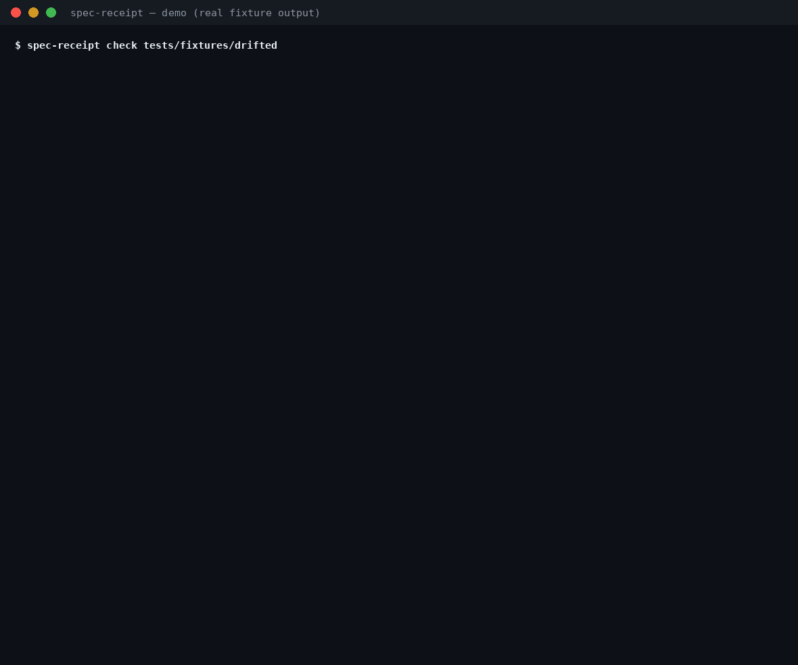

<h1 align="center">spec-receipt</h1>

<p align="center"><strong>Your spec says <code>POST /items</code>. Receipt it — every spec item IMPLEMENTED, MISSING, CONTRADICTED or UNTRACED, every code surface DOCUMENTED or UNDOCUMENTED, with file-and-line evidence.</strong></p>

<p align="center">
  
  
  
  
  
</p>

<p align="center"></p>

A spec is a promise made at design time. Then the code
moves: a flag is deleted, a default quietly changes, an
endpoint's method flips, a forbidden flag sneaks back in,
a feature ships that no document ever mentioned. Review
catches some of it, memory catches less, and the spec
slowly becomes fiction — while still being the document
new contributors, agents, and reviewers trust first.

spec-receipt prints the receipt instead. It extracts what
the spec **declares** (flags, commands, endpoints, config
keys, environment variables, requirement IDs — by
deterministic patterns, from any Markdown spec), extracts
what the code **declares** (the same five surface classes,
by Python AST), and prints a per-item verdict with the
evidence cited on both sides. No LLM. No score. No
network. Nothing uploaded.

**Static and read-only — it executes nothing.** The
target repo is read as Markdown text and Python AST only:
no file is run, imported, compiled, or evaluated. Its own
source imports no network or subprocess module, and the
test suite proves the read-only claim: a fixture module
that would write a marker file if it ran never runs, and
every fixture tree comes out byte-identical after a
check.

Verdicts are stingy by design. **MISSING** is issued
only when a surface class was *completely enumerated*
and the item is absent from it. **CONTRADICTED** needs
hard evidence on both sides — a stated default against a
different code default, a "there is no `--legacy`" against
the flag's own AST node. A prose requirement is never
judged implemented or absent: it is **TRACED** to an
anchor in code or tests, or honestly **UNTRACED**.
Natural language cannot prove a behaviour absent, and
the receipt never pretends it can.

## The receipt family

Three tools, one grammar — *document = claims, code =
evidence, every verdict cited*:

- **[skill-claims](https://github.com/jasveerai88/skill-claims)
  — is the package honest?** Audits an agent skill's
  prose promises against its static behaviour.
- **spec-receipt — does the code still match the
  spec?** Audits a repo's engineering spec against its
  declared implementation surfaces.
- **[done-claim-auditor](https://github.com/jasveerai88/done-claim-auditor)
  — did the agent do what it claimed?** The same
  claim-vs-evidence logic pointed at session
  transcripts.

And before any of them:
**[skill-vet](https://github.com/jasveerai88/skill-vet) —
is it dangerous?** Stealing, spying, hidden sending,
each proven as a combination of evidence.

## Quick start

```bash
pipx install spec-receipt              # or: pip install spec-receipt
spec-receipt check path/to/repo
```

*(Live on PyPI since v1.0.0. Source checkouts also work:
`python3 src/spec_receipt.py check <repo>`, or
`pipx install git+https://github.com/jasveerai88/spec-receipt`.)*

One command, one receipt, an exit code you can gate
on — **1** = drift found (at least one item MISSING or
CONTRADICTED), **0** = no drift, **2** = input error.
Add `--json` for a machine-readable receipt. Python
3.10+, standard library only, no dependencies.

Which file is the spec, in priority order:

1. Explicit `--spec` arguments (repeatable).
2. A `.spec-receipt.toml` manifest in the repo root
   listing `specs = [...]`.
3. Auto-discovery: `SPEC.md` / `spec.md` at root,
   `docs/spec*.md`, `docs/SPEC.md`,
   `specs/**/spec.md`, `DESIGN.md`, `API.md`.
   Nothing found → exit 2.

## What it checks

Five surface classes, extracted from the spec and
indexed from the code, judged in both directions:

| Class | Declared in the spec as | Indexed in the code from |
|---|---|---|
| **CLI flags** | `--name` in backticks, with a stated default (`(default: fast)`) or choice set (``one of `low\|high` ``) | `argparse` `add_argument` and `click` `@click.option`, with defaults and choices, via AST |
| **CLI commands** | A `## Command: name` heading, a backticked invocation line, an invocation line in a fenced block | `add_parser` subcommands, `click` commands and groups, via AST |
| **HTTP routes** | A backticked `` `GET /path` `` span, a row in an Endpoints/API table, an exclusivity statement ("only `GET` on `/items`") | Flask `@*.route`, FastAPI method decorators and `api_route`, Django `path()` / `re_path()` in `urls.py` |
| **Config keys** | A backticked dotted key (`server.port`) under a Configuration heading, or a key in a fenced TOML/INI example | Keys of example/sample/config-named `.toml` / `.ini` / `.json` files, and `config[...]` / `config.get(...)` reads with constant keys |
| **Environment variables** | A backticked `SCREAMING_CASE` name; negations ("never reads `AWS_*`") | `os.environ[...]`, `os.getenv(...)`, `os.environ.get(...)` with constant names, incl. the from-import spellings |

Plus **requirement items**: a line carrying an ID
(`FR-###`, `REQ-<word>`, `R-##`) is traced to an anchor
— the ID verbatim in code or tests (scoped to the ID's
own spec), or two or more of its distinctive statement
terms co-occurring in one in-scope file.

The verdicts:

| Verdict | Applies to | Meaning |
|---|---|---|
| `IMPLEMENTED` | Spec item | The named surface exists in code as specified — AST node cited; any stated default/choices also match. For a negation item: the surface is absent from a completely enumerated class, so the negation holds |
| `MISSING` | Spec item | A structured surface item has no counterpart in code — issued **only** on complete enumeration of its class. Never for requirements, never on partial enumeration |
| `CONTRADICTED` | Spec item | Code proves the opposite of the spec statement, hard evidence on both sides: default vs different default, choices vs different choices, "there is no `--x`" vs the flag's AST node, a spec'd path registered with other methods only, an env negation vs a matching read |
| `TRACED` | Requirement item | The ID has an anchor in code or tests, scoped to its own spec. TRACED never means "correctly implemented" — the receipt says so every time |
| `UNTRACED` | Requirement item (or partial class) | No anchor, or the class could only be partially enumerated. The honest residue — **not** MISSING |
| `DOCUMENTED` | Code surface | A spec item names this surface (a surface named by a negation is DOCUMENTED — named, as forbidden; the item carries the CONTRADICTED) |
| `UNDOCUMENTED` | Code surface | The surface exists in code; no spec item names it |

[Quick start](#quick-start) · [What it checks](#what-it-checks) ·
[How it compares](#how-it-compares) · [Reference](#reference)

## How it compares

| | **spec-receipt** | chenhz01/spec-drift | lilabrooks/spec-drift | spec-kit `/speckit.analyze` |
|---|---|---|---|---|
| The question | Does the **code** still match the **spec**? | Do spec-kit specs and their test anchors agree? | What changed in this diff, per the governing docs? | Do the spec, plan and tasks documents agree? |
| Scope | Whole-repo snapshot, post-hoc | Spec-kit layout only (`specs/NNN/spec.md`, `FR-###`) | A diff range (`base..HEAD`) | In-flow, during authoring |
| What is checked | Five surface classes (flags, commands, routes, config, env) + requirement tracing, **both directions** | FR↔test anchors and spec-vs-spec supersession | The changed files, against their governing documents | Spec ↔ plan ↔ tasks — documents only, never the implementation |
| Method | Deterministic patterns + AST — same repo, same receipt, forever | Lexical, zero-dependency, no LLM | An LLM judges (Anthropic/OpenAI keys, per-file model calls, API cost) | The authoring agent, in the loop |
| Output | Per-item verdicts — MISSING / CONTRADICTED only on complete enumeration or direct conflict — with file + line on both sides | "Candidates, never verdicts" (its own README's words) | LLM drift judgements on the diff | Consistency findings inside the authoring flow |
| Licence / state | MIT, maintained | Apache-2.0 | Proprietary; its README marks the experiment as concluding / being retired | Part of github/spec-kit |

*(Comparable descriptions from their own public pages
and READMEs, checked 2026-11-06. chenhz01/spec-drift is
the closest neighbour and honest prior art — the
stopword + document-frequency filtering its README
found mandatory for term tracing is used here too. The
gap spec-receipt fills is the one `/speckit.analyze`
leaves by design: post-hoc, against the code, in any
Markdown spec format.)*

## Honest limits (the short version)

Static patterns are evidence, not proof. Surfaces built
purely at runtime may not appear in the index; a class
that cannot be fully enumerated is marked partial and
its absence verdicts degrade to UNTRACED rather than
being upgraded to MISSING; prose requirements are
traced, never semantically judged. Extraction is
deliberately scoped — a spec's *examples of its own
notation* are not declarations, and some declaration
shapes are missed as the price of that (each one is
named in the full limits). Every receipt prints its
limits in full; the complete list is
[below](#honest-limits).

---

## Reference

**Contents:** [The drifted fixture](#the-drifted-fixture--the-demo) ·
[The clean fixture](#the-clean-fixture--the-other-direction) ·
[The dogfood gate](#the-dogfood-gate--this-tool-was-caught-lying-first) ·
[For agents](#for-agents) · [Tests](#tests) ·
[Honest limits](#honest-limits)

### The drifted fixture — the demo

`tests/fixtures/drifted/` is a constructed repo whose
code evolved against a frozen `SPEC.md`: one spec'd
flag deleted, one default changed, a forbidden flag
added, one endpoint's method changed from POST to GET,
one undocumented flag grown, one requirement's tests
renamed away. Verbatim output:

```
$ spec-receipt check tests/fixtures/drifted
spec-receipt 1.0.0 — spec drift receipt
Repo: drifted
Spec: SPEC.md
Classes: flags complete (4 surfaces), commands complete (1 surface), routes complete (1 surface), config complete (5 surfaces), env complete (2 surfaces)

SPEC ITEMS
CONTRADICTED flag          --mode                 spec SPEC.md:5 · code app.py:19
             spec states default `fast`; code default is `slow`
MISSING      flag          --level                spec SPEC.md:6 · code —
             the flags class was completely enumerated and --level is absent from it
IMPLEMENTED  flag          --verbose              spec SPEC.md:7 · code app.py:20
             surface declared in code
CONTRADICTED negation      --legacy               spec SPEC.md:8 · code app.py:21
             spec states there is no --legacy; the flag is declared in code
IMPLEMENTED  command       export                 spec SPEC.md:10 · code app.py:24
             command declared in code
TRACED       requirement   FR-001                 spec SPEC.md:16 · code tests/test_app.py:1
             ID FR-001 appears verbatim in code/tests
UNTRACED     requirement   FR-002                 spec SPEC.md:17 · code —
             no verbatim ID and no file carries two distinctive statement terms
IMPLEMENTED  endpoint      GET /items             spec SPEC.md:21 · code app.py:35
             route declared in code with this method
CONTRADICTED endpoint      POST /items            spec SPEC.md:22 · code app.py:35
             spec states POST /items; the path is registered in code with GET only
IMPLEMENTED  config        server                 spec SPEC.md:28 · code config.example.toml:2
             declared in the config index (example config or code read)
IMPLEMENTED  config        server.host            spec SPEC.md:29 · code config.example.toml:3
             declared in the config index (example config or code read)
IMPLEMENTED  config        server.port            spec SPEC.md:30 · code config.example.toml:4
             declared in the config index (example config or code read)
IMPLEMENTED  config        database               spec SPEC.md:31 · code config.example.toml:6
             declared in the config index (example config or code read)
IMPLEMENTED  config        database.url           spec SPEC.md:32 · code config.example.toml:7
             declared in the config index (example config or code read)
IMPLEMENTED  env           ITEMS_API_KEY          spec SPEC.md:48 · code app.py:48
             read in code
IMPLEMENTED  env           ITEMS_REGION           spec SPEC.md:49 · code app.py:49
             read in code
IMPLEMENTED  env-negation  AWS_*                  spec SPEC.md:50 · code —
             negation holds: no matching variable is read in the completely enumerated env class

CODE SURFACES
DOCUMENTED   flag          --mode                 code app.py:19 · spec SPEC.md:5
DOCUMENTED   flag          --verbose              code app.py:20 · spec SPEC.md:7
DOCUMENTED   flag          --legacy               code app.py:21 · spec SPEC.md:8
UNDOCUMENTED flag          --extra                code app.py:22 · spec —
DOCUMENTED   command       export                 code app.py:24 · spec SPEC.md:10
DOCUMENTED   endpoint      GET /items             code app.py:35 · spec SPEC.md:21
DOCUMENTED   config        server                 code config.example.toml:2 · spec SPEC.md:28
DOCUMENTED   config        server.host            code config.example.toml:3 · spec SPEC.md:29
DOCUMENTED   config        server.port            code config.example.toml:4 · spec SPEC.md:30
DOCUMENTED   config        database               code config.example.toml:6 · spec SPEC.md:31
DOCUMENTED   config        database.url           code config.example.toml:7 · spec SPEC.md:32
DOCUMENTED   env           ITEMS_API_KEY          code app.py:48 · spec SPEC.md:48
DOCUMENTED   env           ITEMS_REGION           code app.py:49 · spec SPEC.md:49

Summary: 17 items (IMPLEMENTED 11, MISSING 1, CONTRADICTED 3, TRACED 1, UNTRACED 1); 13 surfaces (DOCUMENTED 12, UNDOCUMENTED 1)
Verdict: DRIFT

Limits:
  - Stage 3 indexes five surface classes: CLI flags and commands (argparse + click, via AST), HTTP routes (Flask, FastAPI and Django URL declarations, via AST), config keys, and environment variables. Declaration forms outside those patterns are not indexed and never judged.
  - Routes: only declared methods are indexed - a Flask route declared without methods counts as GET (its framework default); the automatic HEAD/OPTIONS a framework adds at runtime are not declarations and are not indexed. Django URL routes declare no method, so they are indexed as ANY-method surfaces: they can satisfy, but never contradict, a method-specific spec item. Blueprint/APIRouter constructor prefixes, register_blueprint prefixes and include_router prefixes are applied only when constant and declared in the same module; add_url_rule registrations are not indexed, and their presence marks the routes class partial.
  - Config keys: presence only - values in example configs are never compared with anything. Indexed: keys of example/sample/config-named .toml, .ini and .json files (pyproject.toml and the manifest excluded) and config[...] / config.get(...) reads with constant-string keys, on a receiver named config. YAML configs cannot be parsed with the standard library and are not indexed; their presence marks the config class partial.
  - Environment variables: only os.environ[...], os.getenv(...) and os.environ.get(...) with constant-string names (including the from-import spellings) are indexed. Names built at runtime mark the env class partial.
  - Extraction scope: sections whose headings announce examples or definitions of the notation itself (Examples, Definitions, Glossary, Notation, 'spec item' forms) and lines that present an example (e.g. / for example) or describe the notation (a backticked token, of the form, written as, a placeholder) are illustrative, not declarative: no items are extracted from them. Text inside straight double quotes is quotation — the document talking about wording, not wording that declares — and is likewise never extracted. Template placeholders are not declarations either: an endpoint path whose every segment is a placeholder word (path, x, foo, ...) and a token naming a capitalisation style (SCREAMING_CASE) name the notation, not a surface. A name the document itself defines as one of its terms — in a definition table with a Meaning column, or in an enumerated list of terms with glosses — is vocabulary, not an environment-variable declaration.
  - Fenced blocks: an untagged block counts as config only when it contains at least one key = value assignment, and a [section] header declares a key only when it stands alone on its line — sample output quoted in a spec is not configuration. Invocation lines in fenced blocks do declare commands, but a line invoking a generic shell or package tool (pip, pipx, python, git, ...) names that tool's own operand, never a command of the tool being spec'd.
  - TRACED means a requirement ID has an anchor in code or tests; it never means the requirement is correctly implemented. Anchors are scoped to the requirement's own spec: an anchor must carry the spec's feature qualifier, sit in a file of the feature, or — when the ID is declared by only one spec in its tree — sit in that tree. A comment block that lists an ID as unanchored, or enumerates several IDs, is a denial or a listing, never an anchor — and its words are not term evidence either. An ID found only outside its scope is UNTRACED, not traced to the wrong place. UNTRACED is not MISSING: natural language cannot prove a behaviour absent.
  - MISSING is issued only when the item's surface class was completely enumerated and the item is absent from it; on partial enumeration an absent item is UNTRACED.
  - Static evidence only: nothing in the target repo is executed, imported or run. Surfaces built purely at runtime may not appear in the index.
  - Python code only. A repo with no Python surfaces reports its classes enumerated to empty.
(exit code 1)
```

Note the verdict that gives this tool its name in the
author's own launch post: the spec says `POST /items`;
the path is registered in code with GET only —
CONTRADICTED, cited on both sides (SPEC.md:22 against
app.py:35). And note what is *not* overclaimed:
FR-002's tests were renamed away, so it is UNTRACED —
reported, counted, and not upgraded to MISSING,
because natural language cannot prove a behaviour
absent.

### The clean fixture — the other direction

`tests/fixtures/clean/` declares every surface exactly
— 3 flags (one with a stated default, one with
choices), a command, 2 requirements, a Flask route
pair, 5 config keys, 2 env vars and an env negation —
and the code matches, surface for surface. Verbatim
output (the Limits block, printed identically on every
run, is elided here only):

```
$ spec-receipt check tests/fixtures/clean
spec-receipt 1.0.0 — spec drift receipt
Repo: clean
Spec: SPEC.md
Classes: flags complete (3 surfaces), commands complete (1 surface), routes complete (2 surfaces), config complete (5 surfaces), env complete (2 surfaces)

SPEC ITEMS
IMPLEMENTED  flag          --mode                 spec SPEC.md:5 · code app.py:16
             surface declared in code; stated default and choices match
IMPLEMENTED  flag          --level                spec SPEC.md:6 · code app.py:17
             surface declared in code; stated default and choices match
IMPLEMENTED  flag          --verbose              spec SPEC.md:7 · code app.py:18
             surface declared in code
IMPLEMENTED  negation      --legacy               spec SPEC.md:8 · code —
             negation holds: --legacy is absent from the completely enumerated flags class
IMPLEMENTED  command       export                 spec SPEC.md:10 · code app.py:20
             command declared in code
TRACED       requirement   FR-001                 spec SPEC.md:16 · code tests/test_app.py:1
             ID FR-001 appears verbatim in code/tests
TRACED       requirement   FR-002                 spec SPEC.md:17 · code tests/test_app.py:1
             ID FR-002 appears verbatim in code/tests
IMPLEMENTED  endpoint      GET /items             spec SPEC.md:21 · code app.py:31
             route declared in code with this method
IMPLEMENTED  endpoint      POST /items            spec SPEC.md:22 · code app.py:36
             route declared in code with this method
IMPLEMENTED  config        server                 spec SPEC.md:28 · code config.example.toml:2
             declared in the config index (example config or code read)
IMPLEMENTED  config        server.host            spec SPEC.md:29 · code config.example.toml:3
             declared in the config index (example config or code read)
IMPLEMENTED  config        server.port            spec SPEC.md:30 · code config.example.toml:4
             declared in the config index (example config or code read)
IMPLEMENTED  config        database               spec SPEC.md:31 · code config.example.toml:6
             declared in the config index (example config or code read)
IMPLEMENTED  config        database.url           spec SPEC.md:32 · code config.example.toml:7
             declared in the config index (example config or code read)
IMPLEMENTED  env           ITEMS_API_KEY          spec SPEC.md:48 · code app.py:42
             read in code
IMPLEMENTED  env           ITEMS_REGION           spec SPEC.md:49 · code app.py:43
             read in code
IMPLEMENTED  env-negation  AWS_*                  spec SPEC.md:50 · code —
             negation holds: no matching variable is read in the completely enumerated env class

CODE SURFACES
DOCUMENTED   flag          --mode                 code app.py:16 · spec SPEC.md:5
DOCUMENTED   flag          --level                code app.py:17 · spec SPEC.md:6
DOCUMENTED   flag          --verbose              code app.py:18 · spec SPEC.md:7
DOCUMENTED   command       export                 code app.py:20 · spec SPEC.md:10
DOCUMENTED   endpoint      GET /items             code app.py:31 · spec SPEC.md:21
DOCUMENTED   endpoint      POST /items            code app.py:36 · spec SPEC.md:22
DOCUMENTED   config        server                 code config.example.toml:2 · spec SPEC.md:28
DOCUMENTED   config        server.host            code config.example.toml:3 · spec SPEC.md:29
DOCUMENTED   config        server.port            code config.example.toml:4 · spec SPEC.md:30
DOCUMENTED   config        database               code config.example.toml:6 · spec SPEC.md:31
DOCUMENTED   config        database.url           code config.example.toml:7 · spec SPEC.md:32
DOCUMENTED   env           ITEMS_API_KEY          code app.py:42 · spec SPEC.md:48
DOCUMENTED   env           ITEMS_REGION           code app.py:43 · spec SPEC.md:49

Summary: 17 items (IMPLEMENTED 15, MISSING 0, CONTRADICTED 0, TRACED 2, UNTRACED 0); 13 surfaces (DOCUMENTED 13, UNDOCUMENTED 0)
Verdict: NO_DRIFT
(exit code 0)
```

Any CONTRADICTED on this fixture is a release blocker;
the suite pins it.

### The dogfood gate — this tool was caught lying first

Before v1.0.0, spec-receipt was run against three real
spec'd repos — its own design document, skill-claims,
and the public spec-kit-layout project
chenhz01/spec-drift — with every CONTRADICTED and
every TRACED citation hand-checked against the actual
code. **Run 1 failed the precision bar.** Coverage
passed (67.5% of items received a deterministic
verdict, against a 50% kill line), but all 3
CONTRADICTED verdicts were false in intent: the
extractor had read the design document's *examples of
spec-item forms* — an illustrative `--mode` with a
default, a quoted "no `--legacy`" — as declarations,
and formed verdicts against pairs that should never
have existed. Requirement anchors were also matched
repo-wide, so one feature's `FR-001` was "traced" to
another feature's tests, and two IDs were traced to a
comment block that explicitly lists them as having
*no* anchor.

The fix was one class — extraction scoping, not the
verdict engine: illustrative sections and lines,
template placeholders, the document's own defined
terms, quoted mentions, and sample output no longer
form items; fenced invocation lines do form commands;
anchors are scoped to the requirement's own spec, and
a comment block that denies anchoring is never an
anchor. Every failure shape became a regression test.
**The rerun, unchanged targets and commands: zero
false CONTRADICTED on any target, every TRACED
citation correctly scoped or honestly UNTRACED, mean
coverage 92.6%.** The full reports are in the
project's working notes (`DOGFOOD-SPEC-RECEIPT.md`,
`DOGFOOD-RERUN.md`); the disclosed trade-offs of the
scoping rules are in [Honest limits](#honest-limits).

### For agents

`--json` emits one object: the tool and repo record,
the per-class enumeration state (`complete` /
`surfaces` count, with `index_notes` explaining every
partial marking), the items (each with `kind`, `name`,
spec file + line, code file + line or null, `verdict`,
and `basis`; flags may carry `stated_default` /
`stated_choices`; requirements carry `text`; endpoints
carry `method` and `path`), the surfaces (each with
its verdict and both citations), summary counts that
recount exactly against the items and surfaces, the
overall verdict, the verdict rule, and the limits
statement. Input errors — including argument errors —
are a single JSON object with an `error` key and exit
2. [SKILL.md](SKILL.md) states the full verdict rules
and the JSON contract — and makes spec-receipt itself
installable as a skill: point your agent at this
repo's SKILL.md and it will receipt spec'd repos
before trusting them.

### Tests

```
python3 -m unittest discover -s tests
```

87 tests: both fixtures pinned to the exact verdict
multisets above (clean: 17 items — 15 IMPLEMENTED, 2
TRACED — 13 surfaces all DOCUMENTED, exit 0; drifted:
17 items — 11 IMPLEMENTED, 1 MISSING, 3 CONTRADICTED,
1 TRACED, 1 UNTRACED — 13 surfaces, 1 UNDOCUMENTED,
exit 1); unit tests for every extractor and verdict
rule across all five classes (defaults, choices,
method sets, negations, exclusivity, prefix
resolution); partial-enumeration degradation (dynamic
surfaces degrade absence to UNTRACED, never MISSING);
the error contract (no spec, unreadable spec,
unparseable files — clean `{"error": ...}`, exit 2,
never a traceback, in text and `--json` modes); the
stage-3 regression tests, one per dogfood failure
shape; and the safety proofs — nothing in a target
repo is ever executed, fixture trees are byte-identical
after runs, output is byte-identical across runs, and
the source's imports are pinned to a stdlib set with
no network or subprocess module.

### Honest limits

- **Static evidence only — runtime behaviour is out
  of scope.** Receipt reads the repo's text and AST;
  it never runs anything. Surfaces built purely at
  runtime (routes registered from data, flags built
  in loops from non-constant names) may not appear in
  the index. Where the tool can see a class cannot be
  fully enumerated, it marks the class partial and
  absence verdicts for it degrade to UNTRACED.
- **CONTRADICTED is reserved for hard evidence.** A
  spec statement flips only on a direct conflict
  cited on both sides. A stated parameter whose code
  value is not statically resolvable does not
  contradict — the surface is reported as matching,
  with the parameter unverifiable by construction
  (non-constant choices never contradict a stated
  set; an absent restriction does, because the code
  provably accepts more than the spec allows).
- **Requirements are traced, never judged.** There is
  no verdict for "this prose requirement is correctly
  implemented" and none for "it is absent". TRACED
  means an anchor exists, scoped to the ID's own
  spec — never that the requirement is met.
- **Routes: only declared methods are indexed.** A
  Flask route declared without `methods` counts as
  GET (its framework default); the automatic
  HEAD/OPTIONS a framework adds at runtime are not
  declarations. Django routes declare no method and
  are indexed as ANY-method surfaces: they can
  satisfy, but never contradict, a method-specific
  item. Blueprint/APIRouter constructor prefixes,
  `register_blueprint` and `include_router` prefixes
  are applied only when constant and in the same
  module; `add_url_rule` registrations are not
  indexed, and mark the routes class partial.
- **Config keys are presence only.** Values are
  never compared with anything. Only example/sample/
  config-named `.toml`, `.ini` and `.json` files and
  `config[...]` / `config.get(...)` reads with
  constant-string keys on a receiver named `config`
  are indexed; other receiver names are refused, and
  YAML configs cannot be parsed with the standard
  library — their presence marks the class partial.
- **Environment variables: constant names only.**
  Only `os.environ[...]`, `os.getenv(...)` and
  `os.environ.get(...)` with constant-string names
  (including the from-import spellings) are indexed.
  Names built at runtime mark the env class partial.
- **Extraction scope — the stage-3 trade-offs,
  disclosed.** Sections whose headings announce
  examples or definitions of the notation itself
  (Examples, Definitions, Glossary, Notation,
  "spec item" forms) and lines that present an
  example ("e.g." / "for example") or describe the
  notation are illustrative, not declarative — no
  items are extracted from them; the price is that a
  genuine declaration sharing a line with "e.g." is
  missed too. Text inside straight double quotes is
  quotation and is never extracted. Template
  placeholders are not declarations: an endpoint path
  whose every segment is a placeholder word (`/path`,
  `/x`) names the notation, not a surface — so a
  literal route made only of placeholder words is
  template text to the tool. A name the document
  itself defines as one of its terms (a definition
  table with a Meaning column, an enumerated list of
  terms with glosses) is vocabulary, not an env-var
  declaration — and a term enumeration with
  parenthetical glosses is read the same way, so env
  vars declared in exactly that shape are missed.
  Sample output quoted in a spec is not
  configuration: an untagged fence counts as config
  only with at least one `key = value` assignment,
  and a `[section]` header declares a key only when
  it stands alone on its line.
- **Requirement anchors are scoped.** An anchor must
  carry the spec's feature qualifier (e.g.
  `FR-001 (001)`), sit in a file of the feature, or —
  when the ID is declared by only one spec in its
  tree — sit in that tree. A comment block that lists
  an ID as unanchored, or enumerates several IDs, is
  a denial or a listing, never an anchor — and its
  words are not term evidence either. An ID found
  only outside its scope is UNTRACED, not traced to
  the wrong place.
- **Python implementations only.** Other languages
  are not half-scanned; a repo with no Python
  surfaces reports its classes enumerated to empty,
  plainly.
- **No git/diff mode, no test running, no auto-fix,
  no spec rewriting, no PR comments, no score.** A
  receipt, not a repair tool — and never a drift
  percentage or a grade.

## Contributing

See [CONTRIBUTING.md](CONTRIBUTING.md). The evidence
discipline is the product: a verdict is issued only
on hard evidence, cited on both sides, and
contributions are held to that. Found a repo
spec-receipt misjudges — a declaration it misses, a
verdict the evidence doesn't support? Open an issue
with the repo (or a minimal fixture); that is exactly
the feedback that improves the extraction library.

## Security

spec-receipt is itself an audit tool, so its own
posture is simple: it has no network code, no
subprocess code, no dependencies, and it never
executes what it scans. See [SECURITY.md](SECURITY.md)
for how to report a problem.

## License

MIT — see [LICENSE](LICENSE).

## Related

- [skill-claims](https://github.com/jasveerai88/skill-claims)
  — the honesty half of the receipt family: does a
  skill package do what its description claims?
- [done-claim-auditor](https://github.com/jasveerai88/done-claim-auditor)
  — the same claim-vs-evidence logic pointed at agent
  sessions: audits a coding agent's completion claims
  against its own transcript.
- [skill-vet](https://github.com/jasveerai88/skill-vet)
  — the pre-install danger gate: stealing, spying,
  hidden sending, proven with file-and-line evidence.
- [permission-audit](https://github.com/jasveerai88/permission-audit)
  — audits a Claude Code permission allowlist for
  wildcard grants and dangerous modes before they hurt
  you.

## Support

If spec-receipt catches your code drifting away from
your spec, consider
[sponsoring](https://github.com/sponsors/jasveerai88).
Sponsorship funds the time to maintain spec-receipt, ship
fixes, and build the next checks its users ask for.
